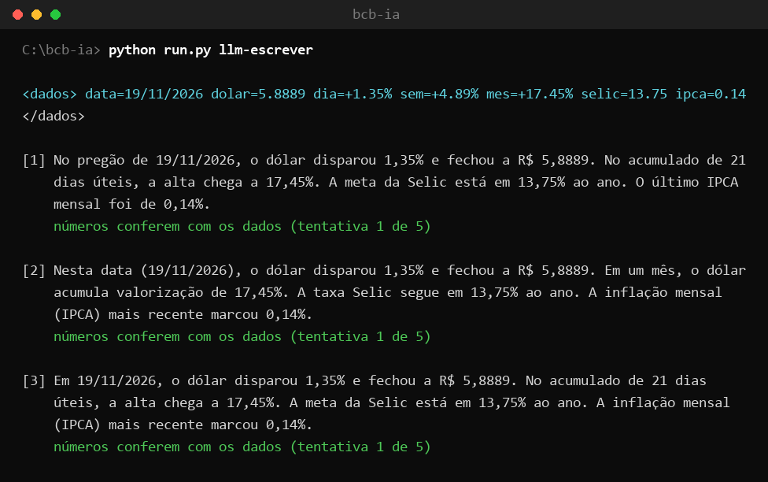
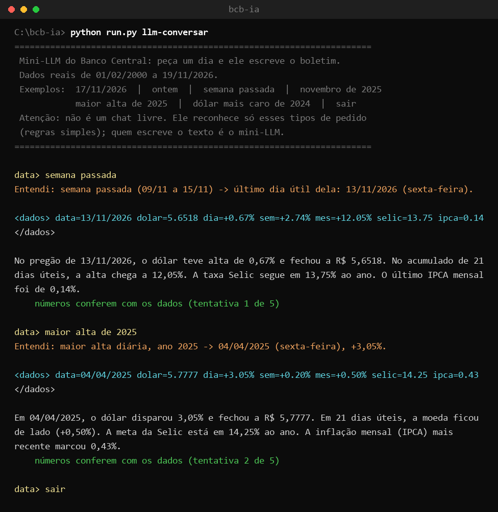

# bcb-ia — de uma linha reta a um mini-LLM, com dados do Banco Central

Projeto educacional que percorre a **escadinha dos 9 algoritmos de machine learning**, em que cada um é uma
pequena mudança do anterior, usando dados **reais e atualizados** da API pública do Banco Central
(dólar, Selic e IPCA). No final, um **mini-LLM escrito do zero** aprende a escrever um boletim em português
a partir desses números.

> Não é recomendação de investimento. O projeto mostra de propósito que prever o dólar de curto prazo é
> muito difícil: nenhum modelo bate a referência "amanhã = hoje".
>
> **Nenhum dado é inventado.** Todos os números vêm da API do Banco Central. O que foi escrito por mim são só
> as frases-modelo (as palavras ao redor dos números) usadas para ensinar o mini-LLM.

```
dados do Banco Central ──► regressão ► logística ► árvore ► floresta ► boosting ► k-NN ► k-means ► rede neural ► mini-LLM
                                                                                                     │
                                  "No pregão de 19/11/2026, o dólar disparou 1,35% e fechou a R$ 5,8889..." ◄─┘
```

## Exemplo

O mini-LLM recebe os dados reais do dia (linha azul) e escreve o boletim. Cada texto passa por um verificador
que confere os números e o sentido das palavras contra os dados do Banco Central (linha verde):



No modo de conversa (`conversar.bat`), você pede um dia: uma data, "semana passada", "maior alta de 2025"...
O programa mostra como entendeu o pedido (linha laranja) e o mini-LLM escreve o boletim daquele dia:



> As imagens são a saída real dos comandos `python run.py llm-escrever` e `python run.py llm-conversar`,
> redesenhadas como imagem de terminal para ficarem legíveis. Como o modelo sorteia as palavras, a redação
> muda a cada execução; os números sempre vêm dos dados do Banco Central.

## Jeito mais fácil (Windows, sem digitar comandos)

1. Neste repositório, clique em **Code → Download ZIP** e extraia em uma pasta de **caminho curto**
   (ex.: `C:\projetos\bcb-ia`).
2. Tenha o **Python 3.10 ou mais novo** ([python.org](https://www.python.org/downloads/), marque *Add python.exe to PATH*).
3. Dois cliques em **`instalar.bat`** (cria o ambiente, instala as bibliotecas e escolhe sozinho o PyTorch
   certo: com placa NVIDIA ou só CPU).
   **Espere aparecer "Pronto!" na janela** (o download do PyTorch pode levar vários minutos e a janela
   fica parada, sem barra de progresso). Só então vá para o passo 4.
4. Dois cliques em **`rodar.bat`**: baixa os dados mais novos do Banco Central e o mini-LLM escreve sobre o
   dia mais recente.
5. (Opcional) Dois cliques em **`conversar.bat`**: você pede um dia (ex.: `17/11/2026`, `semana passada`,
   `maior alta de 2025`) e o mini-LLM escreve o boletim dele, com os dados reais.

Se o Windows mostrar "O Windows protegeu o computador", clique em **Mais informações → Executar assim mesmo**
(acontece com qualquer `.bat` baixado da internet; o conteúdo é texto puro e você pode abrir no Bloco de Notas).

> O **modelo já vem treinado** (`modelos/minillm.pt`, 13 MB). Você **não precisa treinar nada** para ver
> funcionando. Treinar de novo é opcional: ~2 minutos numa placa NVIDIA e quase 3 horas só na CPU.

## A escadinha (a explicação completa está em [docs/ESCADINHA.md](docs/ESCADINHA.md))

| # | Ideia (uma pequena mudança do anterior) | Algoritmo | Onde está no código |
|---|---|---|---|
| 1 | A linha reta mais próxima dos pontos | Regressão linear | `src/modelos.py` |
| 2 | Dobre-a em um "S" para responder sim/não | Regressão logística | `src/modelos.py` |
| 3 | Faça perguntas de sim/não | Árvore de decisão | `src/modelos.py` |
| 4 | Cem árvores votam | Floresta aleatória | `src/modelos.py` |
| 5 | Árvores pequenas consertam os erros que restam | Gradient boosting | `src/modelos.py` |
| 6 | Os 5 pontos mais próximos votam | k vizinhos (k-NN) | `src/modelos.py` |
| 7 | Três centros encontram os grupos, sem respostas dadas | K-means | `src/modelos.py` (`regimes`) |
| 8 | Curvas em "S" empilhadas em camadas | Rede neural | `src/modelos.py` |
| 9 | Torne-a enorme e treine com texto | LLM (aqui, um mini-GPT) | `minillm/` |

## O que você precisa

- **Python 3.10 ou mais novo** e, para o jeito por linha de comando, **Git**.
- **Placa NVIDIA (opcional):** só para **treinar** o mini-LLM de novo. Medido aqui: **0,04 s por passo** numa
  RTX 3060 (2.500 passos em ~2 min) contra **4,03 s por passo** numa CPU de 16 threads (~2 h 48 min).
  Para usar o modelo já treinado, qualquer computador serve.
- Internet, para baixar os dados do Banco Central (não precisa de conta nem de chave).
- A chave da Anthropic **só** é necessária para o `chat` opcional.

## Como baixar e rodar pela linha de comando (Windows PowerShell)

```powershell
# 1. baixar o projeto
git clone https://github.com/CalazansGr/bcb-ia.git
cd bcb-ia

# 2. ambiente isolado (recomendado)
python -m venv .venv
.venv\Scripts\Activate.ps1

# 3. bibliotecas
pip install -r requirements.txt

# 4. PyTorch (escolha UMA das duas linhas)
pip install torch --index-url https://download.pytorch.org/whl/cu124   # com placa NVIDIA (~2,5 GB)
pip install torch                                                      # sem placa (CPU)

# 5. conferir se o PyTorch enxerga a placa (opcional)
python -c "import torch; print('GPU:', torch.cuda.is_available())"
```

No Mac ou Linux, troque o passo 2 por `python3 -m venv .venv` e `source .venv/bin/activate`.

> **Dica para Windows:** clone em uma pasta de caminho curto (ex.: `C:\projetos\bcb-ia`). Caminhos muito
> longos estouram o limite de 260 caracteres do Windows e o `pip` falha com "No such file or directory".

Depois, os comandos (todos a partir da pasta do projeto):

```powershell
python run.py atualizar          # baixa/atualiza dólar, Selic e IPCA do Banco Central
python run.py avaliar            # compara os algoritmos 1 a 8 no mesmo teste
python run.py prever --dias 5    # previsão do dólar com faixa de incerteza
python run.py regimes            # k-means: o dólar está calmo, intermediário ou agitado?
python run.py llm-escrever       # o mini-LLM escreve sobre o dia mais recente do BC
python run.py llm-escrever --data 17/11/2026   # ...ou sobre uma data específica
python run.py llm-conversar      # você pede um dia (data, "semana passada", "maior alta de 2025"...)
python run.py llm-avaliar        # mede a fidelidade do mini-LLM em dias que ele nunca viu
python run.py llm-treinar        # (opcional) treina o mini-LLM do zero
python run.py chat               # (opcional) conversa com o Claude usando esses dados
```

Ordem sugerida para a primeira vez: `atualizar` → `avaliar` → `llm-escrever`.

> **Toda vez que você roda, ele busca o dado mais novo.** O cache fica em `data/` e só baixa o que falta.

### Chat opcional (precisa de chave)

```powershell
pip install -r requirements-chat.txt
```

Copie `.env.example` para `.env`, preencha `ANTHROPIC_API_KEY` (console.anthropic.com, uso pago por consumo)
e rode `python run.py chat`. **Nunca suba o `.env` para o GitHub** (já está no `.gitignore`).

## Resultados reais

### Os dados
Dólar PTAX (venda): **6.752 dias reais**, de 03/01/2000 a 19/11/2026. A série do Banco Central existe desde 1984,
mas antes de julho de 1994 é outra moeda; começamos em 2000 (câmbio flutuante) para usar só dados comparáveis.

### Algoritmos 1 a 8: prever o dólar do dia seguinte
Teste fora da amostra com 1.345 dias (13/07/2021 a 18/11/2026). Treino no passado, teste no futuro.

| Modelo | Erro médio do retorno diário | Acerta sobe/desce |
|---|---|---|
| Referência: amanhã = hoje | **0,586%** | n/a |
| Regressão linear | 0,586% | 50,9% |
| Regressão logística | n/a | 51,6% |
| Árvore de decisão | 0,591% | 52,6% |
| Floresta aleatória | 0,592% | 50,8% |
| Gradient boosting | 0,587% | 51,8% |
| k-NN | 0,652% | 49,4% |
| Rede neural | 0,591% | 50,7% |

**Leitura:** nenhum modelo erra menos que a referência ingênua, e acertar a direção ficou entre 49% e 53%,
perto do acaso (apostar sempre que sobe dá 49,0%). É esperado: o câmbio de curto prazo é quase imprevisível
só com o histórico de preços.

### K-means (algoritmo 7): regimes de mercado

| Regime | Dias | Volatilidade diária média |
|---|---|---|
| calmo | 3.594 | 0,65% |
| intermediário | 2.195 | 0,93% |
| agitado | 932 | 1,27% |

### Mini-LLM (algoritmo 9)
- **Tamanho:** 3,31 milhões de parâmetros (4 camadas, 4 cabeças, dimensão 256, janela de 512 caracteres).
- **Dados:** 6.731 dias reais (os 15% mais recentes ficam de fora do treino, só para validar).
- **Treino:** 2.500 passos em 127 s numa RTX 3060. Perda de treino 0,143 e de validação 0,207.
- **Fidelidade** em **1.010 dias que o modelo nunca viu**, conferindo os números **e** o sentido das palavras
  (não pode dizer "subiu" se caiu):

| | Textos corretos |
|---|---|
| 1ª tentativa, sem ajuda | 990 de 1.010 (**98,0%**) |
| com o verificador (até 5 tentativas) | 1.007 de 1.010 (**99,7%**) |

Nos 3 dias restantes nenhuma das 5 tentativas passou na verificação; nesses casos o programa avisa que o
texto **não confere** (e não o apresenta como correto). Rode `python run.py llm-avaliar` para repetir a medição.

Exemplo, com os dados reais de 19/11/2026:

> No pregão de 19/11/2026, o dólar disparou 1,35% e fechou a R$ 5,8889. No acumulado de 21 dias úteis, a alta
> chega a 17,45%. A taxa Selic segue em 13,75% ao ano.

## O que o mini-LLM é (e o que não é)

**É:** um transformer pequeno escrito do zero em PyTorch (`minillm/modelo.py`), que aprende a prever o
próximo caractere. Recebe uma linha de dados do Banco Central e continua escrevendo o texto.

**Não é:** um economista. Os textos de treino vêm de modelos de frase que eu escrevi
(`minillm/corpus.py`) com várias formas de dizer "subiu", "caiu" etc. O modelo aprende o estilo e a ligação
entre números e palavras. Ele **não analisa nem prevê** nada, e só sabe escrever esse tipo de boletim sobre
dólar, Selic e IPCA. Para outra fonte de dados é preciso definir os campos e as frases e treinar de novo.

**Dá para interagir com ele?** Sim, em um modo de conversa limitado (`conversar.bat` ou
`python run.py llm-conversar`). Você pede um **dia**; o mini-LLM escreve o boletim dele:

| Você digita | O que acontece |
|---|---|
| `17/11/2026`, `2026-03-02`, `17 de março`, `ontem`, `hoje` | usa esse dia (fim de semana ou feriado: o dia útil anterior) |
| `semana passada`, `mês passado`, `novembro de 2025` | o último dia útil com dado desse período |
| `maior alta`, `maior queda`, `dólar mais caro`, `dólar mais barato` | acha o recorde nos dados reais, no período pedido (`de 2025`, `este ano`, `últimos 30 dias`...) |

O programa sempre mostra **como entendeu o pedido**. Quem escolhe o dia são **regras simples**
(`minillm/perguntas.py`, expressões regulares, **sem IA**); quem **escreve o texto** é o mini-LLM. Frases fora desses
tipos ("quanto fecha amanhã?") ele não entende e lista o que reconhece. Para perguntas livres em português existe
o chat com o Claude (`python run.py chat`, opcional, precisa de chave de API).

**O verificador:** depois que o modelo escreve, um código confere o texto contra os dados reais. Se algum
número ou sentido estiver errado, o texto é descartado e ele escreve de novo. Nada é inventado nem corrigido à mão.

**Dica de leitura do histórico:** na primeira versão (antes da faixa "variou pouco"), os erros se concentravam
em variações pequenas, perto do limite entre "estável" e "subiu/caiu". Por isso o corpus agora tem uma faixa
intermediária que cita o número e o sinal.

## Estrutura

```
instalar.bat        # instala tudo (Windows, dois cliques)
rodar.bat           # atualiza os dados e roda o mini-LLM (Windows, dois cliques)
conversar.bat       # você pede um dia e o mini-LLM escreve o boletim (Windows, dois cliques)
run.py              # comandos
modelos/minillm.pt  # mini-LLM já treinado (13 MB)
src/bcb.py          # coleta da API do Banco Central (+ cache)
src/features.py     # tabela de features e alvo
src/modelos.py      # algoritmos 1 a 8, avaliação e k-means
src/previsao.py     # previsão de vários dias com faixa de incerteza
src/chat.py         # chat com o Claude (opcional)
minillm/corpus.py   # dados -> texto de treino
minillm/perguntas.py # entende o pedido ("semana passada", "maior alta") e escolhe o dia (regras simples)
minillm/modelo.py   # o mini-GPT
minillm/treino.py   # treino, verificador, fidelidade e geração
docs/ESCADINHA.md   # os 9 algoritmos explicados
```

## Cuidados metodológicos
- Divisão **treino/teste temporal**. Embaralhar uma série de tempo vaza o futuro e gera resultado falso.
- Toda comparação é feita contra uma referência boba. Quem não a bate não agrega nada.
- A previsão de vários dias é recursiva e a faixa de incerteza (~95%) abre com o tempo.
- Feriados são ignorados no calendário de dias úteis futuros.

## Fonte dos dados
API pública SGS do Banco Central do Brasil: série 1 (dólar PTAX, venda), 432 (meta Selic), 433 (IPCA mensal).

## Licença
[MIT](LICENSE): você pode usar, copiar e modificar livremente, mantendo o aviso de copyright.
